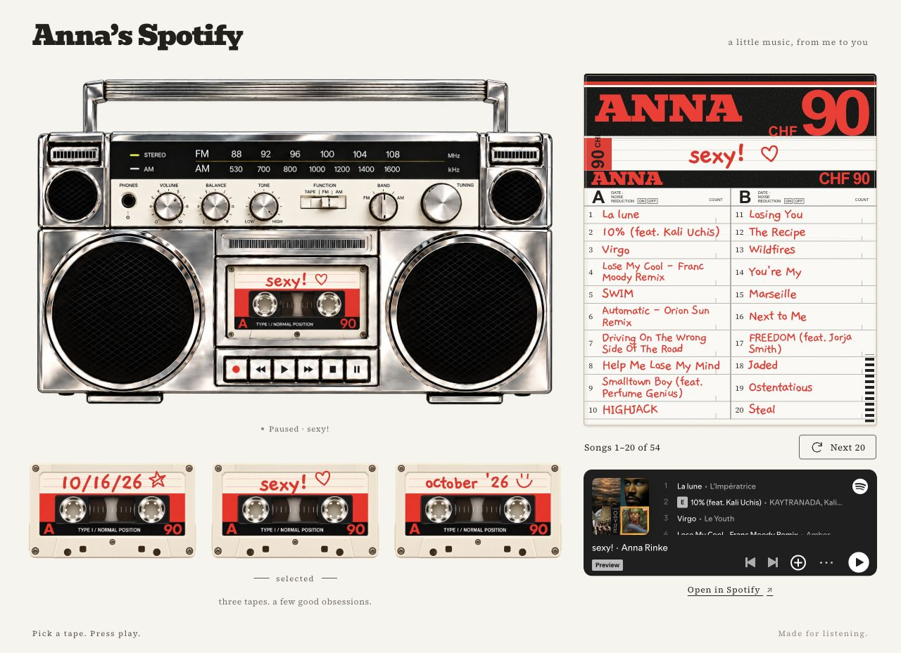

# Make your own Spotify boombox

Your playlists can live on cassette tapes!!! Pick a tape, read the songs on its handwritten paper insert, and listen through Spotify.

I made mine with a chrome boombox, cream cassettes, red marker lettering, and little doodles. **[Try my finished website here](https://anna-spotify-boombox.vercel.app/).** You can make yours look completely different.



You don't need to know how to code. This guide includes the working example, the design details, and a prompt to get started.

## 1. Open Codex or Claude Code and start a new task

You'll describe what you want, review the previews, and ask for changes. Let it handle the project files. You don't need to manually create a folder or upload code to GitHub to start.

## 2. Give it this guide and copy this prompt

```text
Help me make my own interactive Spotify boombox using this guide:
https://github.com/annanoellerinke/spotify-boombox-guide

Read README.md, PERSONALIZE.md, BUILD_GUIDE.md, and ASSETS.md first.
If you cannot open them, tell me so I can attach the files.

Ask for my name, the exact Spotify playlist links I want to share,
inspiration pictures, and design preferences. Start with three playlists.
Each cassette should represent one playlist, and its real playlist name
should appear on the tape, in the boombox, and on the paper insert.

Show me a plan, then an aesthetic mockup, before building the full site.
Let me choose the boombox, cassette colors, handwriting, and heading font.
Use the included working example as a starting point and replace Anna's
name and playlist data with mine. Create the project files for me.

Show the first 20 songs in playlist order, with a button for the next batch.
Use the official Spotify player and an Open in Spotify link.
Don't autoplay, invent song titles, or promise full-song playback.

Show me desktop and phone previews. Keep the version I approve before
trying another direction. Ask before publishing or incurring costs.
```

**[The detailed build guide is here](BUILD_GUIDE.md).**

## 3. Make it feel like you

Have your playlist links ready: open a playlist in Spotify and use **Share → Copy link to playlist**. Use playlists visitors can open. A profile link alone doesn't tell the builder which tapes you want.

Send inspo pictures and explain the details you love. The chrome? A red label? Messy handwriting? A little heart next to the title? You can keep my layout or ask for a different one.

Try feedback like:

> Keep the boombox, but make the tapes cream and completely straight-on.

> The handwriting feels too tidy. Show me five font options before changing it.

> Put my name where ANNA is printed. Keep the actual playlist title on each tape and insert.

**[Use this personalization worksheet](PERSONALIZE.md)** if you want to gather everything first. Review the working preview until the design and interactions feel right.

## 4. Ask to put it online!

When you like the preview, paste:

```text
I approve this version. Publish it to my Vercel account as a separate project.
Check the target account and project so we don't overwrite another website.
Walk me through any sign-in needed and tell me before anything costs money.
Check my name, every playlist, the song lists, Next 20, the Spotify player,
Open in Spotify links, keyboard controls, and the mobile layout.
Verify the public site after deployment and give me the live URL.
```

Then open it on your own phone and in a private browser window before sharing it. You need access to a Vercel account to publish there; your agent can handle the files and supported deployment steps. You can also ask it to save your personalized source in your own GitHub repository.

## A couple of things to know

**Spotify handles the listening.** Its player may offer previews or require sign-in. Some browsers need the first Play click inside the Spotify player; keep that player visible. The boombox doesn't download or host music. [About Spotify embeds](https://developer.spotify.com/documentation/embeds).

**Next 20 changes the paper page.** It doesn't fetch new songs from Spotify. The example's handwritten lists are a saved snapshot; ask your agent to update them and redeploy when you change a playlist.

## What's included?

| File | What it's for |
| --- | --- |
| [BUILD_GUIDE.md](BUILD_GUIDE.md) | The full brief for your coding agent, including playback, song data, and deployment checks. |
| [PERSONALIZE.md](PERSONALIZE.md) | Your name, playlists, design choices, and a fill-in worksheet. |
| [ASSETS.md](ASSETS.md) | How the artwork and live lettering work, plus font credits. |
| [index.html](index.html), [styles.css](styles.css), [character.css](character.css), [app.js](app.js) | The working boombox website. |
| [config.json](config.json), [playlists.json](playlists.json) | Anna's example name, playlist choices, and saved song lists. |
| [sync-playlists.py](sync-playlists.py) | Optional helper for refreshing public playlist metadata. |
| [vercel.json](vercel.json) | Static hosting configuration. |

The example still uses my name and three public playlists. Replace those before sharing your own version. No Spotify password, API key, or paid playback integration is included or required by this example. This is an independent creative project, not an official Spotify product.
